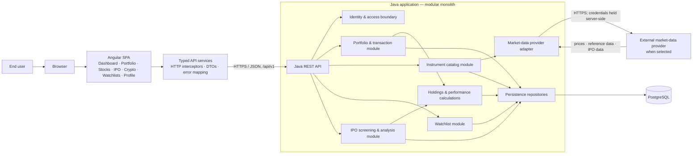
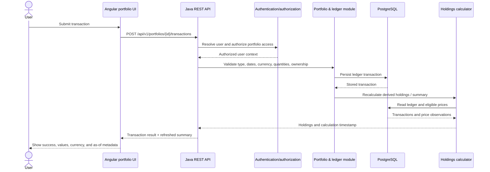
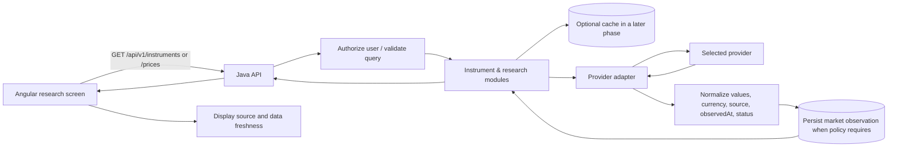
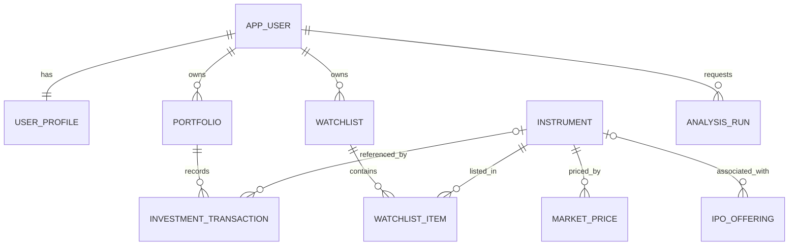

# WealthPilot — Application Architecture and Implementation Plan

> **Status:** Initial architecture baseline (implementation decisions remain open where noted)  
> **Scope:** Angular personal wealth-management application with a Java service and relational database.  
> **Principle:** Begin as a modular monolith. Keep domain boundaries explicit; split services only when scale or team ownership justifies it.

## 1. Goals and guardrails

- Deliver portfolio tracking, market research, IPO screening, crypto/instrument views, and watchlists incrementally.
- Keep business rules, authorization, persistence, and financial calculations on the backend; Angular is a presentation client.
- Use transaction records as the source of truth for holdings. Derive holdings and performance rather than editing a cached position as if it were a trade.
- Keep provider-specific market-data code behind an adapter. Record source and observation time, and represent stale or missing data explicitly.
- Start with read-only tracking and research. This plan does **not** include trade execution, custody, or brokerage integrations.
- Treat analysis as informational, not investment advice. Do not describe sample, delayed, or unavailable data as live.

## 2. System context and component architecture



### Responsibilities

| Component | Responsibility |
|---|---|
| Angular feature areas | Screens, forms, navigation, client-side presentation and input feedback. No financial authority or provider secrets. |
| Typed API services | Encapsulate HTTP calls and map API DTOs to UI models. Start with mock adapters if backend endpoints are not ready. |
| Java REST/API layer | Versioned contracts, authentication integration, authorization, validation, and consistent error responses. |
| Domain modules | Enforce ownership and business rules for profile, portfolios, transactions, instruments, watchlists, and research. |
| Calculation layer | Derive holdings and returns from ledger entries and prices according to documented calculation policies. |
| Provider adapter | Normalize external provider data, handle timeouts/rate limits, and carry source and freshness metadata into the domain. |
| PostgreSQL | Durable user, portfolio, ledger, reference, and analysis data. Schema changes are applied through versioned migrations. |

## 3. Key request and data flows

### 3.1 Record a portfolio transaction and refresh holdings



Reject invalid input with actionable field errors. Never trust a client-supplied user ID to establish ownership. Corrections to completed financial records should be auditable (for example, reversal/correction entries) rather than silent mutation.

### 3.2 Market-data and research flow



A provider outage or absent observation must not silently become a zero price. Define whether each endpoint returns stored last-known data, an unavailable status, or an explicit error. Any last-known value must include its `asOf` time and freshness status.

## 4. Domain model and initial relational schema

Use UUID primary keys, UTC timestamps, ISO currency codes, and `NUMERIC`/decimal types for financial quantities and amounts (never binary floating point). Add foreign keys, `NOT NULL` constraints where applicable, and indexes based on actual query patterns. The schema below is a conceptual baseline; choose exact precision, scale, enum strategy, and deletion policy during migrations.



| Entity/table | Initial fields and constraints |
|---|---|
| `app_user` | `id`, normalized unique `email`, `status`, `created_at`. Authentication credential storage/integration is a security design decision; never store credentials in the Angular app. |
| `user_profile` | `user_id` (PK/FK), `display_name`, `locale`, `timezone`, `preferred_currency`. |
| `portfolio` | `id`, `user_id` (FK), `name`, `base_currency`, `created_at`, nullable `archived_at`. Scope all reads and writes by the authenticated owner. |
| `instrument` | `id`, `symbol`, `name`, `asset_type`, `exchange`, `currency`, `country`, `provider_symbol`, `active`. Define symbol/exchange uniqueness and provider mapping rules. |
| `investment_transaction` | `id`, `portfolio_id` (FK), nullable `instrument_id` (FK for cash-only entries), `type`, `trade_date`, `quantity`, `unit_price`, `fee`, `currency`, `cash_amount`, `notes`, `created_at`. Validate required fields by transaction type. |
| `watchlist` | `id`, `user_id` (FK), `name`, `created_at`. |
| `watchlist_item` | `watchlist_id` (FK), `instrument_id` (FK), `added_at`; unique (`watchlist_id`, `instrument_id`). |
| `market_price` | `id`, `instrument_id` (FK), `price`, `currency`, `observed_at`, `source`, `data_status`. Index (`instrument_id`, `observed_at`). Never overwrite provenance. |
| `ipo_offering` | `id`, nullable `instrument_id` (FK), `company_name`, `exchange`, `expected_date`, `price_low`, `price_high`, `status`, `source`, `updated_at`. Record source/freshness and allow unconfirmed fields. |
| `analysis_run` | `id`, `user_id` (FK), `analysis_type`, `inputs_json`, `result_json`, `data_as_of`, `created_at`. Store criteria and relevant data timestamp to make outputs interpretable. |

### Data integrity and calculation policies

- Store money, quantities, unit prices, and fees using explicit decimal precision and currency. Do not add unlike currencies without an explicit FX conversion rule.
- Keep original transaction facts immutable after posting where feasible. Model corrections with an auditable reversal or correction record and retain actor/time metadata where appropriate.
- Derive a position from transactions. Any cached/materialized summary is disposable and rebuildable from the ledger and price observations.
- Distinguish trade date from record/creation time. Decide how time zones, market close, and non-trading days affect valuation.
- Persist provider/source, observed time, currency, and quality/freshness status with external observations.
- Enforce foreign keys and user ownership in backend logic; test that one user's IDs cannot expose another user's data.

## 5. Initial API contract map

All routes are versioned under `/api/v1`. Use JSON DTOs, consistent validation/error envelopes, pagination for collections, and explicit currency/source/`asOf` metadata. Exact HTTP methods and payloads should be captured in an OpenAPI contract before frontend/backend integration.

| Area | Initial routes |
|---|---|
| Profile | `GET /profile`, `PUT /profile` |
| Portfolios | `GET /portfolios`, `POST /portfolios`, `GET /portfolios/{portfolioId}`, `PATCH /portfolios/{portfolioId}` |
| Ledger | `GET /portfolios/{portfolioId}/transactions`, `POST /portfolios/{portfolioId}/transactions`; correction behavior to be specified explicitly |
| Derived views | `GET /portfolios/{portfolioId}/holdings`, `GET /portfolios/{portfolioId}/summary` |
| Instruments | `GET /instruments?query=...`, `GET /instruments/{instrumentId}`, `GET /instruments/{instrumentId}/prices` |
| Watchlists | `GET /watchlists`, `POST /watchlists`, `POST /watchlists/{watchlistId}/items`, `DELETE /watchlists/{watchlistId}/items/{instrumentId}` |
| IPO research | `GET /ipos` with filters and pagination; provider-backed data availability is a later decision |
| Analysis | `POST /analysis` with a defined type and validated inputs; response identifies assumptions and data timestamp |

Use stable API error codes and a predictable shape, for example: `code`, `message`, optional `fieldErrors`, and `requestId`. Do not expose stack traces or provider credentials to clients.

## 6. Frontend and backend organization

### Angular

```text
src/app/
  core/          # app-wide configuration, auth integration, API client, interceptors
  shared/        # reusable UI, formatting, loading/error states
  features/
    dashboard/
    portfolio/   # portfolio views, transactions, holdings
    stocks/      # instrument search/details
    ipo/
    crypto/
    watchlists/
    profile/
    auth/        # screens/integration only; backend remains auth authority
```

Keep feature-specific state local initially (Angular Signals or existing project conventions). Introduce broader state management only when cross-feature complexity warrants it. Put HTTP access behind typed feature services; keep mock implementations behind the same interface during incremental integration.

### Java service

Organize by domain feature rather than a single large controller/service package:

```text
<base-package>/
  shared/          # error model, clock, shared primitives
  identity/        # auth integration and user context
  portfolio/       # API, application/domain logic, persistence
  instrument/      # catalog and provider-neutral models
  watchlist/
  research/        # IPO and analysis use cases
  marketdata/      # provider port, adapter, normalization
```

Keep controllers thin. Put validation and use-case coordination in application services; keep business rules testable without HTTP or database dependencies. Use database migrations as the reviewed schema source of truth.

## 7. Security, reliability, and operations baseline

- Use HTTPS outside local development; keep secrets in the server-side secret/configuration system, not source control or Angular bundles.
- Integrate a suitable authentication provider/flow before exposing personal data. Enforce authorization on every object-level operation.
- Validate and bound user inputs; rate-limit sensitive or expensive endpoints as appropriate. Avoid logging credentials, tokens, or unnecessary financial details.
- Add database backups and a restore test before relying on persisted user records. Define retention/deletion requirements and audit needs.
- Add health/readiness endpoints, structured logs with request IDs, metrics, and monitoring for API and provider failures.
- Make provider calls time-bounded and handle rate limits/outages. A provider adapter should support contract tests and a deterministic stub for local development.
- Test financial calculations with decimal arithmetic, boundary cases, and fixed test fixtures. Avoid asserting performance results without agreed calculation definitions.

## 8. Implementation phases and acceptance checkpoints

1. **Agree on product and data policies** — transaction types, cost basis, returns, FX, provider, freshness, authentication approach, privacy/retention, and MVP scope. Record decisions below.
2. **Backend foundation** — confirm Java framework/build conventions, create migrations, health/error conventions, API contract, and test baseline.
3. **Ledger MVP** — portfolios, transaction recording/listing, ownership enforcement, and derived holdings. Test validation, reversals/corrections, decimal calculations, and cross-user access denial.
4. **Angular API integration** — typed API services and loading/empty/error states; replace mock data incrementally while preserving a mock adapter for development.
5. **Instrument catalog and watchlists** — search and organization of instruments; support unavailable data explicitly.
6. **Market data and research** — choose provider and licensing, implement adapter and provenance/freshness, then IPO screening and analysis with visible assumptions.
7. **Production readiness** — auth and security review, backup/restore test, monitoring, rate limits, privacy requirements, and documented operational procedures.

A phase is complete only when its API behavior is documented, authorization is tested, errors/loading/empty states are handled, and any displayed financial values carry the required currency and data timing context.

## 9. Decisions to resolve before production calculations

- Which transaction types ship first (buy, sell, dividend, fee, deposit, withdrawal, split, transfer)?
- Which cost-basis method is required (for example, FIFO or average cost), and how are corrections and corporate actions represented?
- Are returns time-weighted, money-weighted, or both? How are deposits/withdrawals treated?
- Which FX source and timestamp convention apply to multi-currency valuation?
- Which market-data/IPO provider is licensed and available? What do freshness tiers and outage behavior mean?
- What is the authentication model, user deletion/retention policy, and audit requirement?
- Is analysis limited to user-entered holdings and public information, and what disclosures are required?

Until these are decided, label relevant functionality as prototype/sample and avoid claiming authoritative live valuation or investment recommendations.

## 10. Decision log

| Date | Decision | Status / owner |
|---|---|---|
| 2026-11-08 | Start with an Angular SPA and Java modular monolith, backed by PostgreSQL; keep provider integration behind an adapter. | Baseline proposal; validate with project owner |
| 2026-11-08 | Ledger transactions are the source of truth; holdings are derived. | Baseline proposal; calculation policies still open |
| 2026-11-08 | Initial scope excludes order execution and brokerage custody. | Baseline proposal |
